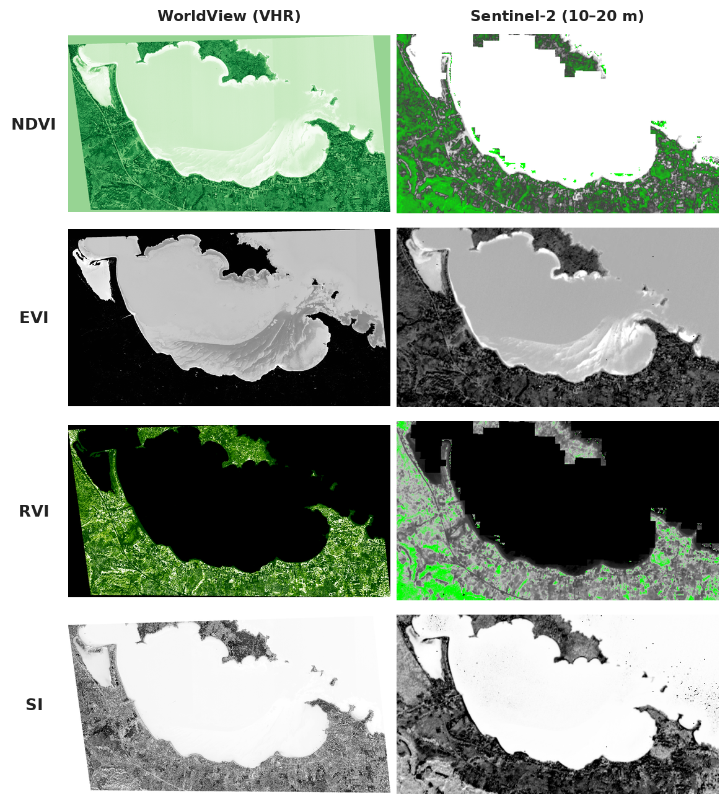
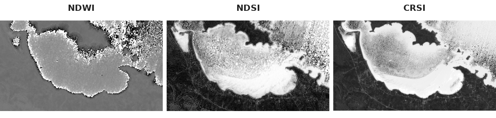
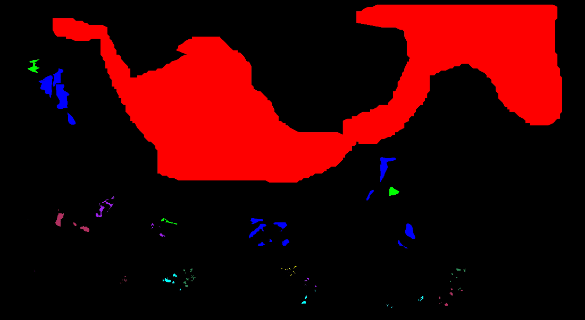

# Comparative Multispectral Analysis & LULC Mapping: WorldView vs. Sentinel-2

A comparative remote sensing study focusing on pan-sharpening data fusion, biophysical and salinity spectral indices, and land cover classification benchmarking across **Very High Resolution (VHR) WorldView** and **ESA Sentinel-2** imagery over Vourvourou, Chalkidiki (Greece).

📄 **[Read the Full Technical Report (PDF - Greek)](./Multispectral_Analysis_WorldView_Sentinel2_Report.pdf)**

<p align="center">
  
  <br><em>WorldView imagery of Vourvourou bay: true colour (left) and false colour infrared (right)</em>
</p>

---

## 📌 Project Overview
This project investigates the complementary use of Very High Resolution (WorldView) and medium-resolution multispectral imagery (Copernicus Sentinel-2) for coastal and terrestrial environmental monitoring. The workflow covers radiometric analysis, spatial resolution enhancement via pan-sharpening, spectral index modeling, and machine learning classification pipelines.

---

## 🛠️ Methodological Workflow & Processing Pipeline

### 1. Data Fusion & Pan-Sharpening (ENVI)
* Evaluated True Color (RGB 5-3-2) and False Color Infrared (CIR 7-4-3) composite behavior for vegetation delineation.
* Performed **Gram-Schmidt Spectral Sharpening** to fuse high-resolution panchromatic band data with multispectral channels, enhancing spatial detail of infrastructure and coastlines while preserving spectral fidelity.

### 2. Spectral Indices & Cross-Sensor Comparison
Computed and cross-evaluated multiple spectral indices across both sensors:
* **Vegetation Monitoring:** Normalized Difference Vegetation Index (**NDVI**), Enhanced Vegetation Index (**EVI**), and Ratio Vegetation Index (**RVI**).
* **Water & Moisture Extraction:** Normalized Difference Water Index (**NDWI**, utilizing Sentinel-2 SWIR bands with 20 m resampling).
* **Salinity & Soil Degradation:** Normalized Difference Salinity Index (**NDSI**) and Salinity Index 1 (**SI-1**) to detect surface salt concentration in shallow lagoons and coastal fringes.

<p align="center">
  
  <br><em>Cross-sensor comparison of spectral indices: WorldView (left) vs. Sentinel-2 (right)</em>
</p>

<p align="center">
  
  <br><em>Water and salinity indices from Sentinel-2: NDWI, NDSI and CRSI</em>
</p>

### 3. Classification Pipelines & Machine Learning Benchmark
* **Unsupervised Clustering:** Applied **ISODATA** (20 iterations, 5% threshold) to segment 10 exploratory spectral classes.
* **Supervised Spectral Classification:** Implemented **Spectral Angle Mapper (SAM)** on calibrated ROIs across 9 thematic classes (Overall Accuracy: **95.3%**, Kappa Coefficient: **0.83**).
* **Support Vector Machine (SVM):** Trained an SVM classifier in ENVI on WorldView data, achieving an Overall Accuracy of **95.47%** and Kappa Coefficient of **0.95**.
* **Random Forest (RF):** Supervised ensemble classification executed in **ESA SNAP** on Sentinel-2 L2A (10 trees, 5,000 training samples, 9 classes), using spectral indices (NDVI, EVI, RVI, CRSI-type and SI-type ratios) as feature bands – see [the reconstructed SNAP graph](./processing/snap/random_forest_graph.xml).
* **Object-Based Image Analysis (OBIA):** Executed **Multiresolution Segmentation** in **eCognition** (parameterized Scale, Shape, Compactness) and built class hierarchies/training objects to assess object-level vs. pixel-level boundary constraints under high-resolution memory workloads.

<p align="center">
  
  <br><em>Training regions of interest (ROIs) digitized in ENVI on the pan-sharpened WorldView image</em>
</p>

### Classification results

| Unsupervised (ISODATA, WorldView) | Supervised SVM (WorldView) |
| :---: | :---: |
|  |  |
| **Random Forest (Sentinel-2, SNAP)** | **Multiresolution segmentation (OBIA, eCognition)** |
|  |  |

---

## 💻 Software & Data Sources
* **Software:** ENVI, ESA SNAP, Trimble eCognition, epsg.io
* **Sensors:** WorldView (VHR Multispectral & Panchromatic), Copernicus Sentinel-2 MSI (Bands 2, 3, 4, 8, 11)
* **Study Area:** Vourvourou, Sithonia, Chalkidiki, Greece

---

## ⚙️ Processing Details & Reproducibility

The analysis was carried out in desktop software, so this repository documents the processing chain rather than code:

| Step | Software | Details |
| :--- | :--- | :--- |
| Pan-sharpening | ENVI | Gram-Schmidt, WorldView panchromatic + multispectral → 0.5 m |
| ISODATA | ENVI | 10 spectral classes, 20 iterations, 5% change threshold |
| SAM | ENVI | 9 classes: Sea, Limnothalassa (lagoon), Crops, Coastline, Low and High vegetation, Ground, Shallow water, Buildings |
| SVM | ENVI | 9 classes on the 2 m WorldView multispectral image |
| Land/sea mask & NDVI | SNAP | Land-Sea-Mask and NDVI operators (Optical Toolbox) |
| Random Forest | SNAP 12 | Resample to the B1 grid → index feature bands → Random-Forest-Classifier (10 trees, 5,000 samples) |
| OBIA | eCognition | Multiresolution segmentation, 9-class hierarchy and training samples; the final Nearest Neighbor classification could not be completed because of the memory load of the 0.5 m image |

* [`processing/snap/random_forest_graph.xml`](./processing/snap/random_forest_graph.xml) – SNAP graph (runnable with `gpt`), reconstructed from the processing history stored in the product metadata.
* [`processing/envi/`](./processing/envi/) – training ROIs for the SAM and SVM classifications (ENVI `.roi` format).
* [`processing/ecognition/class_hierarchy.dkb`](./processing/ecognition/class_hierarchy.dkb) – eCognition class hierarchy used for the object-based classification.

The WorldView imagery is commercial data and is not redistributed; the Sentinel-2 scene (tile T35TKE, 22 October 2020) is freely available from the [Copernicus Data Space Ecosystem](https://dataspace.copernicus.eu/).

## 📁 Repository Structure

```
├── processing/
│   ├── snap/random_forest_graph.xml       # Sentinel-2 Random Forest workflow
│   ├── envi/                              # Training ROIs (SAM, SVM)
│   └── ecognition/class_hierarchy.dkb     # OBIA class hierarchy
├── images/                                # Figures used in this README
└── Multispectral_Analysis_WorldView_Sentinel2_Report.pdf
```
