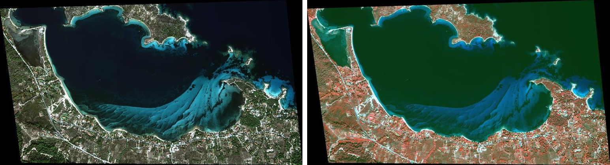
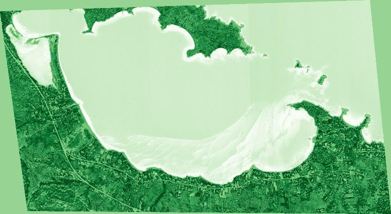
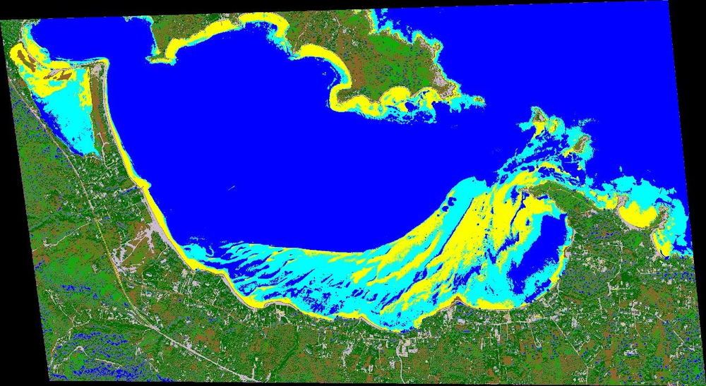
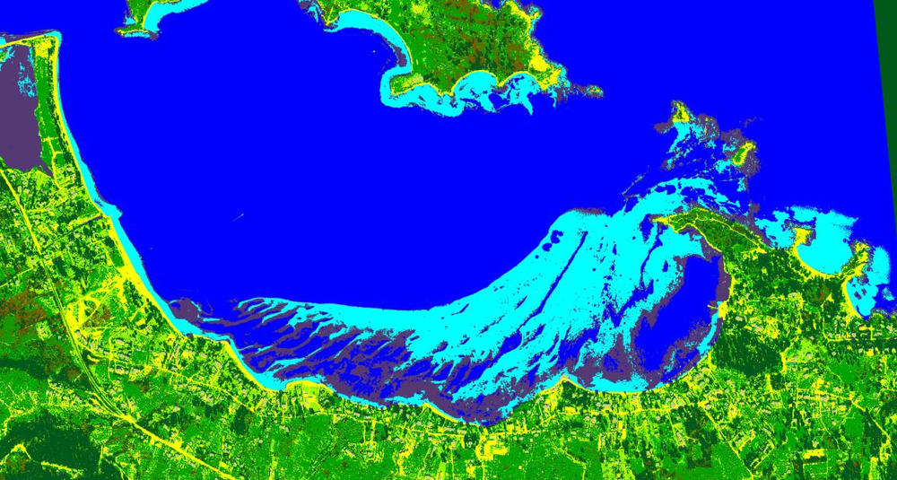
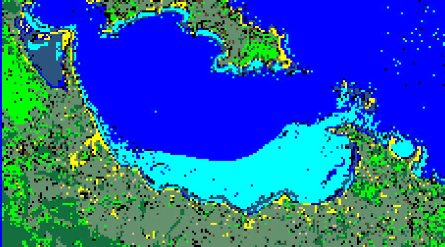
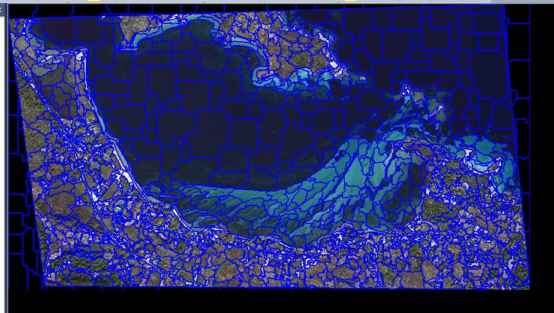

# Comparative Multispectral Analysis & LULC Mapping: WorldView vs. Sentinel-2

A comparative remote sensing study focusing on pan-sharpening data fusion, biophysical and salinity spectral indices, and land cover classification benchmarking across **Very High Resolution (VHR) WorldView** and **ESA Sentinel-2** imagery over Vourvourou, Chalkidiki (Greece).

📄 **[Read the Full Technical Report (PDF - Greek)](./Multispectral_Analysis_WorldView_Sentinel2_Report.pdf)**

  
   <em>WorldView imagery of Vourvourou bay: true colour (left) and false colour infrared (right)</em>

---

## 📌 Project Overview
This project investigates the complementary use of Very High Resolution (WorldView) and medium-resolution multispectral imagery (Copernicus Sentinel-2) for coastal and terrestrial environmental monitoring. The workflow covers radiometric analysis, spatial resolution enhancement via pan-sharpening, spectral index modeling, and machine learning classification pipelines.

---

## 🛠️ Methodological Workflow & Processing Pipeline

### 1. Data Fusion & Pan-Sharpening (ENVI)
* Evaluated True Color (RGB 5-3-2) and False Color Infrared (CIR 7-4-3) composite behavior for vegetation delineation.
* Performed **Gram-Schmidt Spectral Sharpening** to fuse high-resolution panchromatic band data with multispectral channels, enhancing spatial detail of infrastructure and coastlines while preserving spectral fidelity.

### 2. Spectral Indices & Cross-Sensor Comparison
Computed and cross-evaluated multiple spectral indices across both sensors:
* **Vegetation Monitoring:** Normalized Difference Vegetation Index (**NDVI**), Enhanced Vegetation Index (**EVI**), and Ratio Vegetation Index (**RVI**).
* **Water & Moisture Extraction:** Normalized Difference Water Index (**NDWI**, utilizing Sentinel-2 SWIR bands with 20 m resampling).
* **Salinity & Soil Degradation:** Normalized Difference Salinity Index (**NDSI**) and Salinity Index 1 (**SI-1**) to detect surface salt concentration in shallow lagoons and coastal fringes.

  
   <em>NDVI computed from WorldView imagery</em>

### 3. Classification Pipelines & Machine Learning Benchmark
* **Unsupervised Clustering:** Applied **ISODATA** (20 iterations, 5% threshold) to segment 10 exploratory spectral classes.
* **Supervised Spectral Classification:** Implemented **Spectral Angle Mapper (SAM)** on calibrated ROIs across 9 thematic classes (Overall Accuracy: **95.3%**, Kappa Coefficient: **0.83**).
* **Support Vector Machine (SVM):** Trained an SVM classifier in ENVI on WorldView data, achieving an Overall Accuracy of **95.47%** and Kappa Coefficient of **0.95**.
* **Random Forest (RF):** Supervised ensemble classification executed in **ESA SNAP** on Sentinel-2 bands for macro-scale land cover mapping.
* **Object-Based Image Analysis (OBIA):** Executed **Multiresolution Segmentation** in **eCognition** (parameterized Scale, Shape, Compactness) and built class hierarchies/training objects to assess object-level vs. pixel-level boundary constraints under high-resolution memory workloads.

### Classification results

| Unsupervised (ISODATA, WorldView) | Supervised SVM (WorldView) |
| :---: | :---: |
|  |  |
| **Random Forest (Sentinel-2, SNAP)** | **Multiresolution segmentation (OBIA, eCognition)** |
|  |  |

---

## 💻 Software & Data Sources
* **Software:** ENVI, ESA SNAP, Trimble eCognition, epsg.io
* **Sensors:** WorldView (VHR Multispectral & Panchromatic), Copernicus Sentinel-2 MSI (Bands 2, 3, 4, 8, 11)
* **Study Area:** Vourvourou, Sithonia, Chalkidiki, Greece
