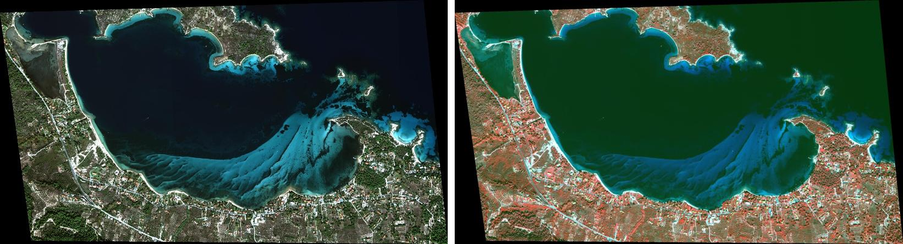
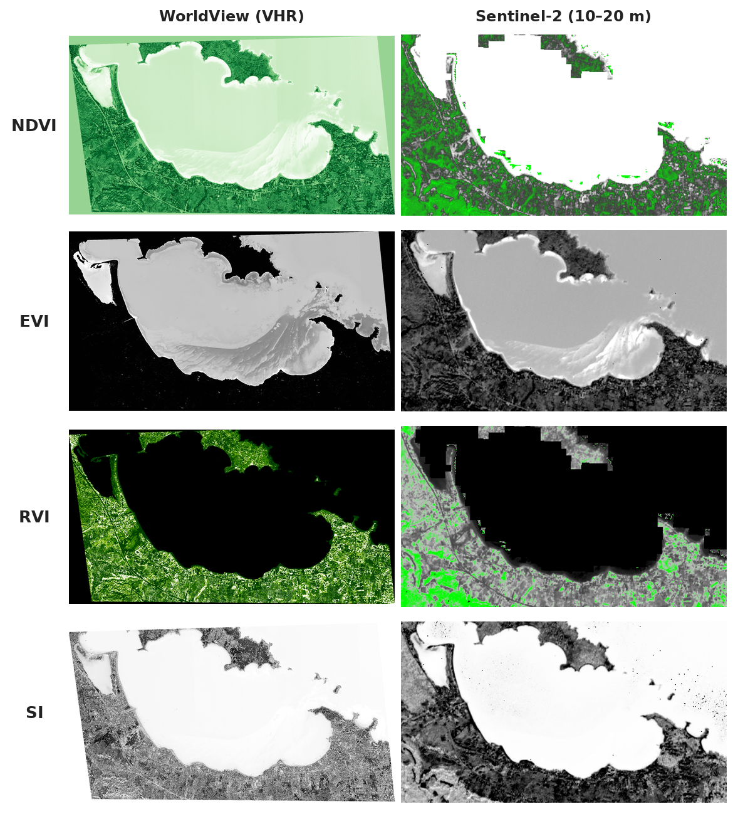
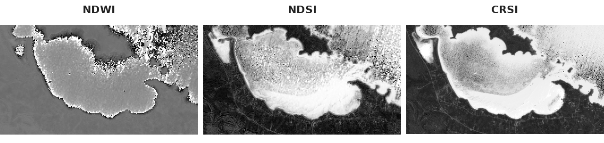
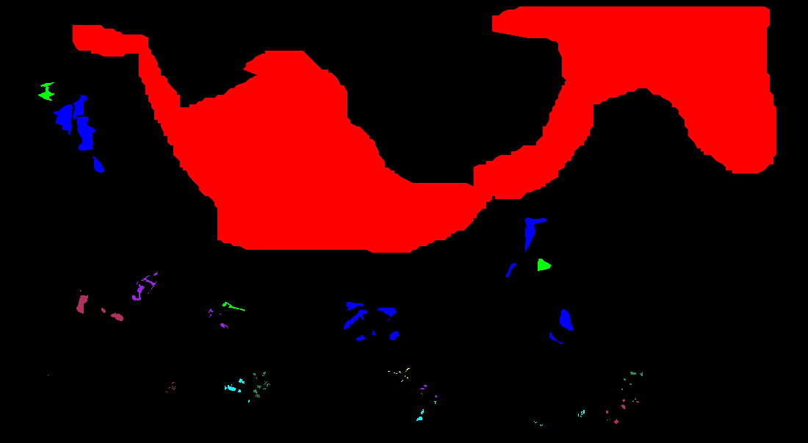
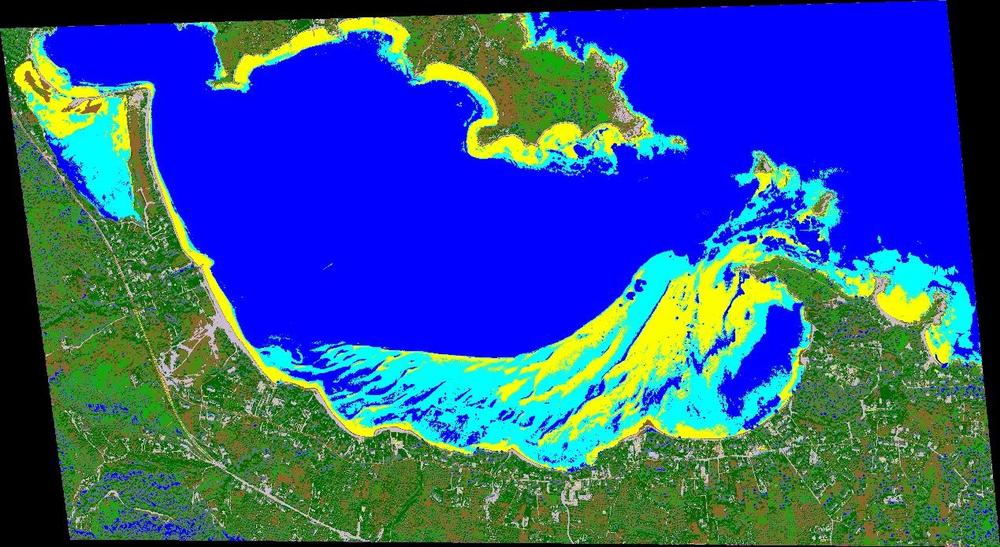
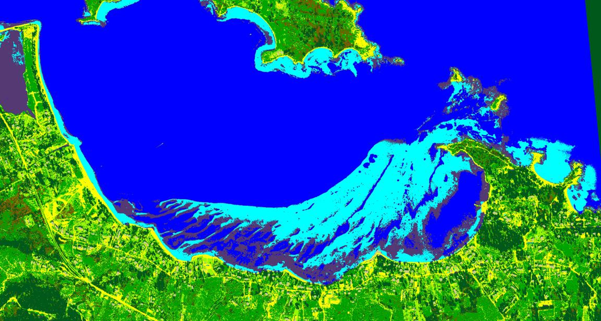
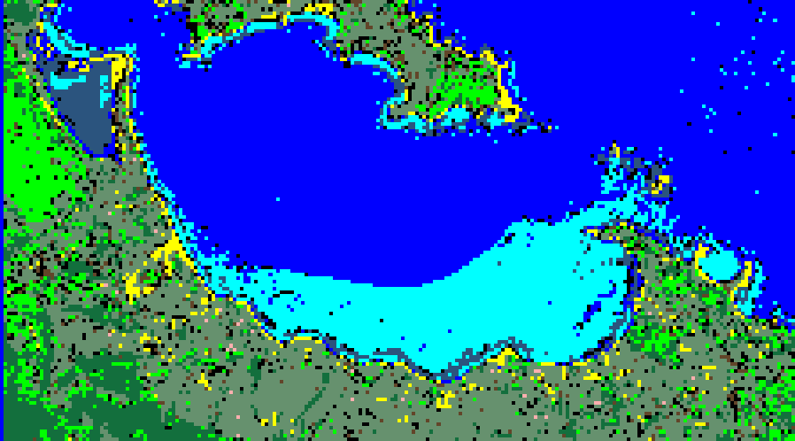
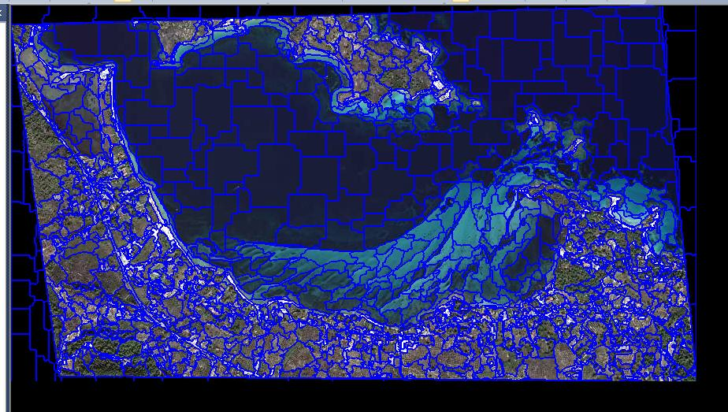

# Multispectral Analysis & Land-Cover Mapping: WorldView-3 vs. Sentinel-2

A university project (MSc course *Remote Sensing & Machine Learning*) comparing **Very High Resolution (VHR) WorldView-3** and **ESA Sentinel-2** imagery over Vourvourou, Chalkidiki (Greece). It covers pan-sharpening, vegetation / water / salinity-related spectral indices, and land-cover classification experiments carried out in desktop software (ENVI, ESA SNAP, eCognition).

📄 **[Full technical report (PDF, in Greek)](./Multispectral_Analysis_WorldView_Sentinel2_Report.pdf)**

<p align="center">
  
  <br><em>WorldView-3 imagery of Vourvourou bay: true colour, bands 5-3-2 (left) and false colour, bands 7-4-3 (right)</em>
</p>

---

## 📌 Project Overview

The study investigates how VHR (WorldView-3) and medium-resolution (Sentinel-2) multispectral imagery complement each other for coastal and terrestrial monitoring. The WorldView-3 scene was supplied already radiometrically and atmospherically corrected. The workflow covers composite visualisation, resolution enhancement by pan-sharpening, spectral index computation on both sensors, and unsupervised, supervised and object-based classification.

**Main take-aways**
* Gram-Schmidt pan-sharpening visibly improved the detail of roads, buildings and coastline (assessed visually).
* WorldView-3 resolves small-scale vegetation variability; Sentinel-2 smooths values through mixed pixels but is sufficient for large-area patterns.
* The supplied WorldView-3 product contains only the 8 VNIR bands (no SWIR), so SWIR-based indices could only be computed from Sentinel-2.
* Supervised classification (SAM, SVM) clearly outperformed unsupervised ISODATA visually; the Sentinel-2 Random Forest map was noisier (see limitations).

---

## 🛠️ Methodological Workflow

### 1. Composites & Data Fusion (ENVI)
* True colour composite (WorldView-3 bands 5-3-2) and false colour infrared composite (bands 7-4-3: NIR1, yellow, green) to compare vegetation delineation. A band 3-4-6 combination suggested by the assignment was tried first.
* **Gram-Schmidt Spectral Sharpening** to fuse the panchromatic band (~0.5 m) with the multispectral bands (~2 m). The result was assessed visually; no quantitative fusion-quality metric was computed.

### 2. Spectral Indices & Cross-Sensor Comparison
Indices were computed on both sensors where the required bands exist:

| Index | Formula (as implemented) | Bands (S2 / WV-3) | Sensors |
| :--- | :--- | :--- | :--- |
| NDVI | (NIR − Red) / (NIR + Red) | B8, B4 / 7, 5 | S2, WV-3 |
| EVI | 2.5 · (NIR − Red) / (NIR + 6·Red − 7.5·Blue + 1) | B8, B4, B2 / 7, 5, 2 | S2, WV-3 |
| RVI | NIR / Red | B8, B4 / 7, 5 | S2, WV-3 |
| NDWI | (NIR − SWIR) / (NIR + SWIR) | B8, B11 (20 m) | S2 only |
| "NDSI" | (Green − SWIR) / (Green + SWIR) | B3, B11 (SWIR resampled to 10 m) | S2 only |
| CRSI | (Red·NIR − Blue·Green) / (Red·NIR + Blue·Green) | B4, B8, B2, B3 / 5, 7, 2, 3 | S2, WV-3 |
| SI-1 | (Red · NIR) / Green | B4, B8, B3 / 5, 7, 3 | S2, WV-3 |

Notes on interpretation:
* **NDWI** here is the NIR/SWIR formulation (Gao), which reflects canopy water content / moisture, not open water.
* **"NDSI"** as implemented, (Green − SWIR)/(Green + SWIR), is mathematically the MNDWI / snow-index formulation. It highlights **water**, so it is high over the sea; it should not be read as a salt indicator.
* **CRSI** (Canopy Response Salinity Index) is designed for crops affected by salinity; the commonly published form applies a square root to the ratio, which was not applied here. **SI-1** definitions vary in the literature. Both are exploratory in this study; no field salinity data were available to validate them.
* A land/sea mask was applied to NDVI and RVI on Sentinel-2 because water produced unreliable values.

<p align="center">
  
  <br><em>Cross-sensor comparison of spectral indices: WorldView-3 (left) vs. Sentinel-2 (right)</em>
</p>

<p align="center">
  
  <br><em>Water and salinity-related indices from Sentinel-2: NDWI, NDSI and CRSI</em>
</p>

### 3. Classification Experiments
* **Unsupervised (ISODATA, ENVI):** 10 spectral classes, 20 iterations, 5 % change threshold, on the pan-sharpened image. Classes were named by visual interpretation. The result is described in the report as a "moderate attempt" (e.g. some sea pixels assigned to coastline).
* **Supervised – Spectral Angle Mapper (ENVI):** 9 classes (sea, lagoon, crops, coastline, low vegetation, high vegetation, ground, shallow water, buildings) from training ROIs chosen for spectral homogeneity and geographic spread; accuracy assessed on separate validation samples.
* **Supervised – SVM (ENVI):** same 9 classes. Running on the full 0.5 m sharpened image exceeded the available memory, so the SVM was run on the **2 m multispectral image with a reduced number of ROIs**.
* **Random Forest (SNAP, Sentinel-2 L2A):** the product was resampled to the **60 m grid of band B1** (≈ 222 × 123 pixels over the study area, i.e. much coarser than the native 10 m bands). 10 trees, 5,000 training samples, 9 classes, with spectral indices as feature bands (see the [reconstructed SNAP graph](./processing/snap/random_forest_graph.xml)). Evaluated qualitatively and with spatially distributed check points; no overall accuracy figure was recorded.
* **Object-Based Image Analysis (eCognition):** Multiresolution Segmentation (scale, shape and compactness tested), class hierarchy and training objects defined. The final Nearest Neighbor classification **could not be completed** because of the memory load of the 0.5 m image, so there is no OBIA classification result or accuracy.

<p align="center">
  
  <br><em>Training regions of interest (ROIs) digitised in ENVI on the pan-sharpened WorldView-3 image</em>
</p>

### Classification results

| Method | Data | Classes | Overall accuracy | Kappa | Remarks |
| :--- | :--- | :---: | :---: | :---: | :--- |
| ISODATA | WV-3 pan-sharpened | 10 clusters | – | – | Exploratory, visual interpretation |
| SAM | WV-3 | 9 | 95.3 % | 0.83 | Separate validation samples |
| SVM | WV-3, 2 m multispectral, reduced ROIs | 9 | 95.47 % | 0.95 | Validation set differs from SAM (see limitations) |
| Random Forest | Sentinel-2 L2A, resampled to 60 m | 9 | not reported | – | Qualitative assessment only |
| OBIA (eCognition) | WV-3, 0.5 m | 9-class hierarchy | not completed | – | Segmentation only |

| Unsupervised (ISODATA, WorldView-3) | Supervised SVM (WorldView-3) |
| :---: | :---: |
|  |  |
| **Random Forest (Sentinel-2, SNAP)** | **Multiresolution segmentation (OBIA, eCognition)** |
|  |  |

---

## ⚠️ Limitations

* **The accuracy figures are not directly comparable.** SAM (OA 95.3 %, κ 0.83) and SVM (OA 95.47 %, κ 0.95) have almost the same overall accuracy but very different Kappa, which implies different class distributions in their validation sets. The lower Kappa of the SAM is the more conservative figure.
* **The SVM ran on reduced data** (2 m multispectral image, fewer ROIs), so its accuracy is indicative and probably optimistic.
* **SVM vs. Random Forest is not a controlled comparison:** different sensor, resolution, software and validation points. The Random Forest ran on Sentinel-2 data resampled to a 60 m grid (about 30 times coarser than the 2 m WorldView-3 multispectral image used for the SVM), which is consistent with its noisier, blocky result. With only ≈ 27,000 pixels in the scene, 5,000 training samples is a large share of the image, so the check points should be independent of them. Resampling to a 10 m reference band would be the first thing to redo.
* **Object-based classification was not completed**; only the segmentation stage is documented.
* **Salinity-related indices are exploratory** and were not validated with ground data; "NDSI" as implemented is a water index (see above).
* **The three-point reflectance comparison** between the two sensors used values in different units (Sentinel-2 reflectance × 10,000 vs. WorldView-3 image values), so it illustrates material differences rather than a calibrated cross-sensor comparison. A negative Sentinel-2 value over deep water (B4 = −38) is typical of over-correction on dark surfaces.
* **Area estimates depend strongly on the method**: crops ≈ 260 stremmata (ISODATA) vs. ≈ 574 (SAM); built-up ≈ 350 vs. ≈ 213.
* Pan-sharpening quality was judged visually only.

---

## 💻 Software & Data Sources
* **Software:** ENVI, ESA SNAP, Trimble eCognition, epsg.io
* **Sensors:** WorldView-3 (products `WV3_OPER_WV1_8B__2A` and `WV3_OPER_WV1_PAN_2A`, level 2A: 8 VNIR bands + panchromatic, acquired 22 October 2020, supplied for the course), Copernicus Sentinel-2 MSI L2A (tile T35TKE, 22 October 2020; bands 2, 3, 4, 8 at 10 m; 11 at 20 m). The two scenes were acquired about eight minutes apart (≈09:10 and ≈09:18 UTC), so temporal differences play no role in the cross-sensor comparison.
* **Study area:** Vourvourou, Sithonia, Chalkidiki, Greece

---

## ⚙️ Processing Details & Reproducibility

The analysis was carried out in desktop software, so this repository documents the processing chain rather than code:

| Step | Software | Details |
| :--- | :--- | :--- |
| Pan-sharpening | ENVI | Gram-Schmidt, WorldView-3 panchromatic + multispectral → ~0.5 m |
| ISODATA | ENVI | 10 spectral classes, 20 iterations, 5 % change threshold |
| SAM | ENVI | 9 classes: Sea, Limnothalassa (lagoon), Crops, Coastline, Low and High vegetation, Ground, Shallow water, Buildings |
| SVM | ENVI | 9 classes on the 2 m WorldView-3 multispectral image (reduced ROIs) |
| Land/sea mask & NDVI | SNAP | Land-Sea-Mask and NDVI operators (Optical Toolbox) |
| Random Forest | SNAP 12 | Resample (reference band B1, 60 m) → index feature bands → Random-Forest-Classifier (10 trees, 5,000 samples) |
| OBIA | eCognition | Multiresolution segmentation, class hierarchy and training samples; final Nearest Neighbor classification not completed (memory load of the 0.5 m image) |

* [`processing/snap/random_forest_graph.xml`](./processing/snap/random_forest_graph.xml): SNAP graph (runnable with `gpt`), reconstructed from the processing history stored in the product metadata.
* [`processing/envi/`](./processing/envi/): training ROIs for the SAM and SVM classifications (ENVI `.roi` format).
* [`processing/ecognition/class_hierarchy.dkb`](./processing/ecognition/class_hierarchy.dkb): eCognition class hierarchy used for the object-based work.

The WorldView-3 imagery is commercial data and is not redistributed. The Sentinel-2 scene (tile T35TKE, 22 October 2020) is freely available from the [Copernicus Data Space Ecosystem](https://dataspace.copernicus.eu/).


## 📁 Repository Structure

```
├── processing/
│   ├── snap/random_forest_graph.xml       # Sentinel-2 Random Forest workflow
│   ├── envi/                              # Training ROIs (SAM, SVM)
│   └── ecognition/class_hierarchy.dkb     # OBIA class hierarchy
├── images/                                # Figures used in this README
└── Multispectral_Analysis_WorldView_Sentinel2_Report.pdf
```
